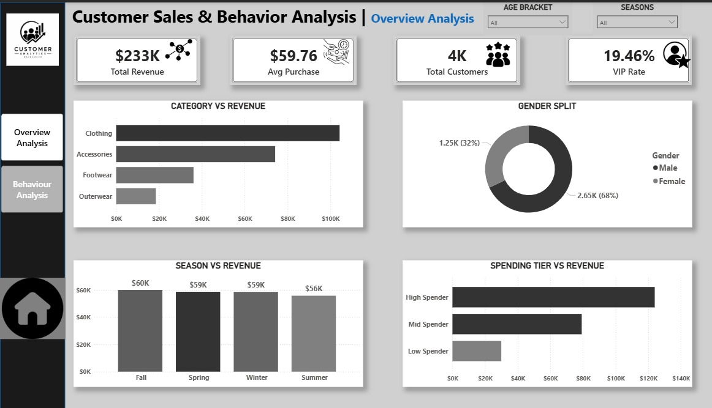
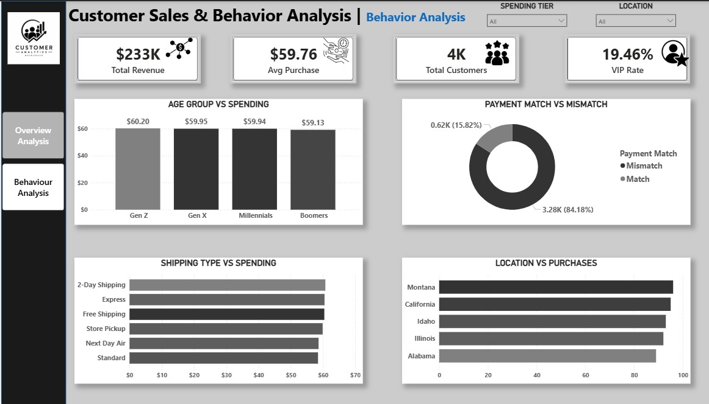

# Customer Sales and Behavior Analysis

## Project Overview

This project explores customer purchasing behavior and sales performance to understand what customers buy, how much they spend, and which patterns stand out in the data.

Using Power BI and Microsoft Excel, I analyzed customer demographics, product categories, seasonal sales, payment preferences, shipping methods, and purchasing activity across different states.

The aim was to turn the data into useful business insights that could help guide marketing, customer retention, inventory planning, and sales decisions.

## Project Objectives

- Evaluate overall revenue and customer activity.
- Understand customer demographics and spending patterns.
- Identify the best-performing product categories.
- Compare sales performance across seasons and locations.
- Explore payment preferences and shipping behavior.
- Recommend practical actions based on the findings.

## Dashboard Preview

### Sales Performance and Customer Insights

### Customer Behavior and Purchasing Patterns

## Tools Used

- **Power BI:** Built the dashboards and explored sales and customer trends.
- **Microsoft Excel:** Cleaned and prepared the data for analysis.

## Key Performance Indicators

| Metric | Result |
|---|---:|
| Total Revenue | $233K |
| Total Customers | 4K |
| Average Purchase Value | $59.76 |
| Female Customers | 68% |
| Male Customers | 32% |

## Key Findings

### 1. Overall Sales Performance

The analysis recorded **$233K in revenue across 4K customers**, with an average purchase value of $59.76.

These figures provide a snapshot of the business's sales performance and customer spending during the period covered by the dataset.

### 2. Clothing Was the Leading Product Category

Clothing performed better than Accessories, Footwear, and Outerwear in the category comparison.

This makes clothing an important area to monitor when reviewing product demand and planning promotions. Looking more closely at individual products could also reveal which items contributed most to category sales.

### 3. Female Customers Made Up the Larger Share

Female customers represented 68% of the customer base, compared with 32% for male customers.

This shows how the customer base was distributed in the dataset. Comparing revenue and average purchase value across both groups would provide a clearer picture of their respective contributions to sales.

### 4. Sales Varied by Season

Fall recorded the highest revenue, while Summer recorded the lowest.

This pattern could help inform seasonal promotions and inventory planning. Reviewing monthly sales and product demand would help determine whether the difference was consistent across the period analyzed.

### 5. High-Spending Customers Contributed the Most Revenue

High spenders accounted for the largest share of revenue among the customer spending segments analyzed.

Understanding what these customers purchase and how frequently they buy could help the business explore more relevant loyalty offers and customer retention strategies.

### 6. Gen Z Recorded an Average Spending Value of $60.20

Gen Z customers had an average spending value of $60.20 in the analysis.

This provides a starting point for comparing spending patterns across generations and understanding whether different customer groups may respond to different marketing approaches.

### 7. Most Customers Used Their Preferred Payment Methods

The analysis showed that 84.18% of customers used their preferred payment methods, while 15.82% used alternative methods.

These figures provide a view of payment preferences within the dataset. Further analysis could help determine whether payment choices are associated with differences in purchase value or customer experience.

### 8. Shipping Methods Showed Differences in Customer Spending

Customers using 2-Day and Express shipping recorded higher spending than those using Standard shipping.

This is a useful pattern to investigate, but it does not necessarily mean faster shipping leads to higher spending. Comparing order values, customer segments, and delivery costs could help explain the difference.

### 9. Purchasing Activity Varied Across States

Montana, California, and Idaho recorded some of the highest purchasing activity in the analysis.

Comparing total revenue, customer counts, and average purchase value across states would help determine where the business has stronger sales activity and where further market analysis may be worthwhile.

## Business Recommendations

Based on the patterns identified, I would recommend investigating the following opportunities:

1. **Review clothing performance:** Examine individual product sales to identify popular items and potential promotional opportunities.
2. **Improve customer segmentation:** Use purchasing patterns and customer demographics to develop more relevant marketing campaigns.
3. **Explore customer retention:** Investigate loyalty offers for high-spending customers and measure their effectiveness.
4. **Plan for seasonal demand:** Use historical sales patterns to support inventory decisions and promotional planning.
5. **Evaluate shipping options:** Compare delivery costs, order values, and customer preferences before making changes to shipping services.
6. **Investigate regional performance:** Compare revenue and customer activity across states before committing additional marketing resources.
7. **Review payment preferences:** Use the findings to assess whether the available payment options meet customer needs.

These are potential actions based on the analysis, rather than outcomes already tested by the business.

## Analytical Approach

I prepared the data in Excel and used Power BI to explore the main performance indicators and customer behavior patterns.

The analysis focused on revenue, product categories, customer segments, seasonal trends, payment preferences, shipping methods, and geographic activity. I then used the dashboard findings to identify business questions and develop recommendations for further investigation.

The main focus was not just presenting the numbers, but understanding what they could tell us about customer behavior and sales performance.

## Skills Demonstrated

- Data cleaning and preparation
- Power BI dashboard development
- Sales performance and KPI analysis
- Customer behavior and segmentation
- Product category analysis
- Seasonal and geographic trend analysis
- Business intelligence and data visualization
- Communicating findings and recommendations

## Limitations

The findings reflect the data available in the dataset and should be interpreted within that context. The analysis identifies patterns and differences but does not establish what caused them.

Additional analysis would be needed to validate the recommendations, particularly where decisions involve marketing expenditure, shipping costs, customer retention, or profitability.

## About Me

I am an Economics undergraduate at the University of Port Harcourt, interested in Data Analytics, Business Intelligence, and Business Analytics.

I use tools such as Power BI and Excel to explore business data, identify meaningful patterns, and present findings in a way that supports informed decision-making.

**Tools:** Power BI | Microsoft Excel

**GitHub:** https://github.com/dbusiness-analytics

**LinkedIn:** https://www.linkedin.com/in/daniel-basil-60aa43363/

---

*This project demonstrates how customer and sales data can be used to identify purchasing patterns, assess business performance, and highlight opportunities for further analysis.*
